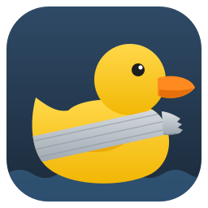
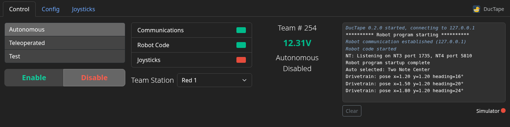
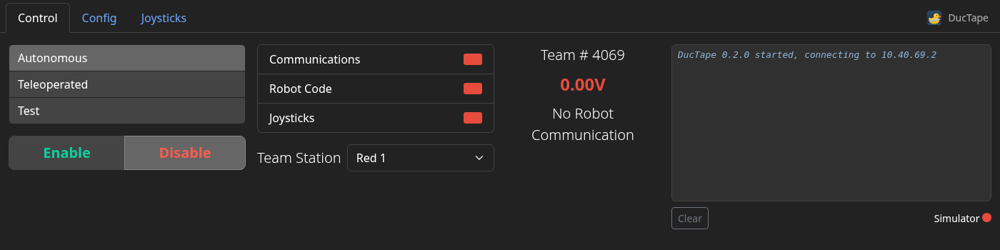
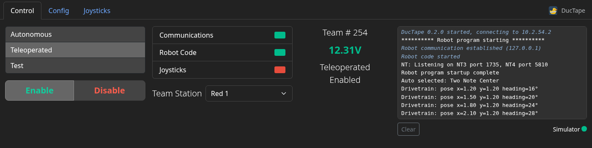
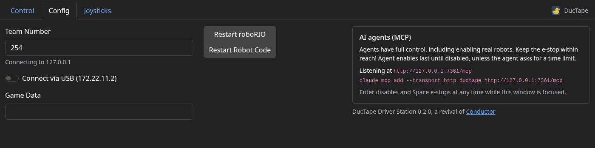
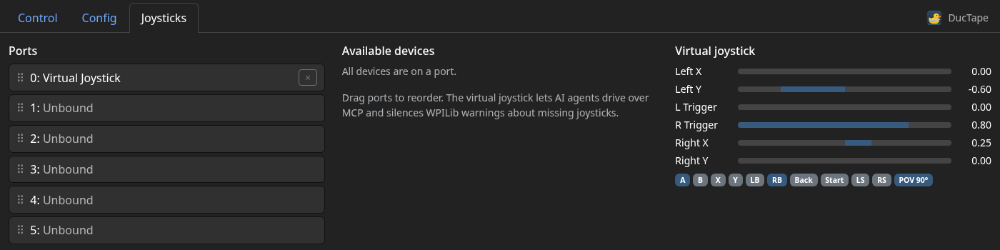
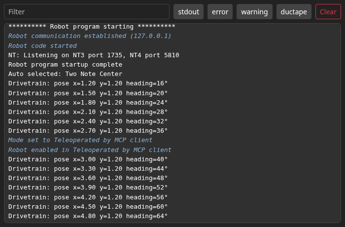
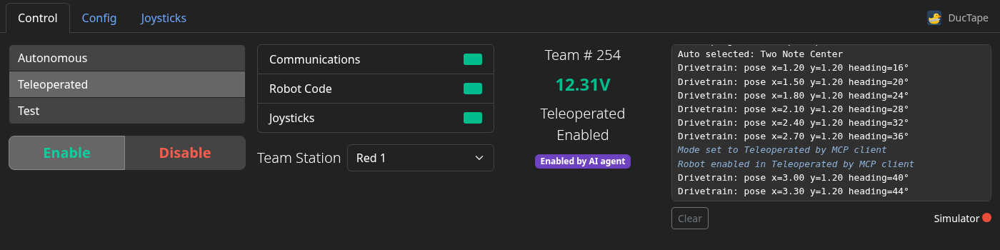

<p align="center">
  
</p>

<h1 align="center">DucTape Driver Station</h1>

<p align="center">
  A cross-platform driver station for FRC robots, which AI agents can drive too.
</p>

<p align="center">
  <a href="https://github.com/RohanBhattacharyya/DucTape/actions/workflows/ci.yml"></a>
</p>

DucTape is a driver station for FRC robots on Linux and macOS. It supports nearly<sup>*</sup> every feature of the NI Driver Station, and includes a [Model Context Protocol](https://modelcontextprotocol.io) server so AI agents such as Claude can run it: check the robot's status, enable it, run tests in the WPILib simulator, read the console and drive a virtual joystick.

DucTape is a revival of [Conductor](https://github.com/Redrield/Conductor) by Kaitlyn Kenwell, which was archived in 2026. It keeps Conductor's design and protocol library, rebuilt on a current stack with Linux packages and MCP support.

<sup>*</sup>DucTape cannot auto-launch dashboards, and is not and will never be compatible with the Field Management System, so it can't be used in competition.



- [Installing](#installing)
- [Usage](#usage)
- [AI agents (MCP)](#ai-agents-mcp)
- [Command line](#command-line)
- [Troubleshooting](#troubleshooting)
- [Building and contributing](#building-and-contributing)

# Installing

## Linux packages

Every [release](https://github.com/RohanBhattacharyya/DucTape/releases) has packages for x86_64 and aarch64:

| Distribution | Install |
| --- | --- |
| Debian, Ubuntu 22.04+, Mint, Pop!_OS | `sudo apt install ./ductape_*.deb` |
| Fedora, RHEL, openSUSE | `sudo dnf install ./ductape-*.rpm` |
| Arch, Manjaro, CachyOS | `makepkg -si` with [`packaging/arch/PKGBUILD`](packaging/arch/PKGBUILD) |
| Anything else | `tar -xzf ductape-*-linux.tar.gz -C ~/.local --strip-components=1` |

Packages install a desktop entry, so DucTape shows up in your application menu.

## From source

The install script installs build dependencies (apt, dnf, pacman or zypper), a Rust toolchain if yours is missing or older than 1.88, and a private copy of Node.js if yours is older than 20.19. It then builds DucTape and installs it into `~/.local`:

```sh
curl -fsSL https://raw.githubusercontent.com/RohanBhattacharyya/DucTape/HEAD/scripts/install.sh | sh
# or from a checkout, optionally system-wide:
./scripts/install.sh --system
```

Or do it by hand. You need Rust 1.88+, Node.js 20.19+ and the WebKitGTK 4.1 development files (`libwebkit2gtk-4.1-dev libgtk-3-dev libudev-dev libx11-dev` on Debian/Ubuntu):

```sh
git clone https://github.com/RohanBhattacharyya/DucTape && cd DucTape
make release            # or just `cargo build --release`; it builds the web UI too
sudo make install       # PREFIX=/usr/local by default
```

`cargo install --git https://github.com/RohanBhattacharyya/DucTape --locked` also works.

## macOS

Download `DucTape-*-macos-aarch64.zip` from the releases, or build it yourself with `cargo install cargo-bundle && cargo bundle --release`. Global hotkeys need the Input Monitoring permission (System Settings → Privacy & Security).

## Headless

DucTape can run without windows (`ductape --headless`) and serve its UI to a browser. Builds with `--no-default-features` don't need WebKitGTK at all, for example on a Raspberry Pi.

## Coming from Conductor

DucTape imports your Conductor settings (`~/.config/conductor/conductor.toml`) the first time it runs, and saves its own to `~/.config/ductape/ductape.toml`.

# Usage

DucTape follows the layout of the NI Driver Station. The main window has three tabs, Control, Config and Joysticks, and a second window shows the robot console.

Enter disables the robot and Space e-stops it. On X11 these work even when DucTape isn't focused, like the NI Driver Station; on Wayland, which doesn't allow global hotkeys, they work while a DucTape window is focused.

## Control



On the far left are selectors for the mode, and buttons to enable or disable the robot. In the middle are indicators for communication, robot code and joysticks (hover a red one for an explanation), the team station, team number, battery voltage and the robot's status. On the right is a smaller view of the robot console.

The simulator indicator lights up when DucTape is connected to a WPILib simulation on the same machine instead of a robot. DucTape switches to a running simulation automatically.



## Config



The team number sets the address DucTape connects to, the familiar 10.TE.AM.2. "Connect via USB" overrides this to reach the roboRIO's USB interface at `172.22.11.2`. Game data sets the Game Specific Message given to robot code. In the middle are buttons to restart robot code and reboot the roboRIO, and on the right is how to connect AI agents.

## Joysticks



Robot code sees six joystick ports. Controllers are put on the first free port when they're plugged in; drag ports to reorder them, or move devices on and off ports. The Virtual Joystick can be put on a port to silence WPILib warnings about unplugged joysticks, and is what AI agents use to drive; its live state is shown on the right. Unplugging a controller that is on a port disables the robot.

## Robot console



The console window shows everything robot code prints, WPILib errors and warnings, and notices from DucTape, such as when an agent enables the robot. It can be filtered by text and by kind.

# AI agents (MCP)

DucTape is an MCP server. Agents get tools to read status, set the team number, mode, alliance and game data, enable, disable and e-stop, restart code, reboot the roboRIO, wait for the robot to connect, read the console, manage joystick ports and drive the virtual joystick. The `run_mode` tool runs a mode for a set time and returns the console output, which makes it easy to ask an agent to "run auto in the simulator and tell me why it crashes".



*The window shows when an agent enabled the robot*

Run `ductape mcp-setup` to print these instructions with the right paths.

**Claude Code**

```sh
claude mcp add ductape -- ductape mcp          # headless
claude mcp add ductape -- ductape mcp --gui    # with windows, so you can watch and take over
```

**Claude Desktop, Cursor, VS Code, and other clients**

```json
{
  "mcpServers": {
    "ductape": { "command": "ductape", "args": ["mcp", "--gui"] }
  }
}
```

**Attaching to a DucTape window you already have open**

Only one driver station can talk to a robot at a time. To let an agent use the window you're already running, start it with `--mcp-http` and connect over Streamable HTTP:

```sh
ductape --mcp-http
claude mcp add --transport http ductape http://127.0.0.1:7341/mcp
```

## Access and safety

Agents have full control by default, including enabling real robots, and their enables last until they (or you) disable the robot. An agent can ask for a timed enable by passing `duration_seconds`, and `run_mode` is always timed. You can restrict agents:

| Option | Config (`[mcp]` in `ductape.toml`) | Effect |
| --- | --- | --- |
| `--mcp-enable simulator` | `enable_policy = "simulator"` | Agents may only enable the WPILib simulator |
| `--mcp-enable never` | `enable_policy = "never"` | Agents may not enable anything |
| `--mcp-max-enable 30` | `max_enable_secs = 30` | Every agent enable is disabled after at most 30 seconds |

Whatever the settings:

- Disable and e-stop always work, for agents and for you. The window shows when an agent enabled the robot, and any timed enable's countdown.
- Enabling needs communication and running robot code, and changing mode disables the robot, as with the NI Driver Station.
- DucTape disables the robot when communication drops, so it doesn't come back enabled.
- In `ductape mcp` modes, global hotkeys are off so that typing to your agent can't e-stop the robot; Enter and Space still work in DucTape's window.
- The HTTP endpoint only listens on localhost and rejects requests from web pages.

# Command line

```
ductape [OPTIONS]                open the driver station
ductape mcp [--gui]              MCP server on stdin/stdout
ductape mcp-setup                print MCP client configuration

  -t, --team <TEAM>              team number (saved)
      --usb                      connect over USB (172.22.11.2)
      --robot-ip <IP>            connect to this address instead
      --headless                 no windows; serve the UI to a browser
      --ui-addr <ADDR>           address for the UI server [default: 127.0.0.1:0]
      --mcp-http [<ADDR>]        also serve MCP over HTTP [default: 127.0.0.1:7341]
      --mcp-enable <POLICY>      restrict agents: always | simulator | never [default: always]
      --mcp-max-enable <SECONDS> time-limit agent enables [default: untimed]
      --no-global-hotkeys        only handle Enter/Space in DucTape's window
      --config <PATH>            use another config file
```

Logging goes to stderr; set `DUCTAPE_LOG=debug` for more.

# Troubleshooting

- **Blank window on Wayland** (often with NVIDIA): run `WEBKIT_DISABLE_DMABUF_RENDERER=1 ductape`.
- **"UDP port 1150 is in use"**: another driver station, or another DucTape, is running. Only one can talk to a robot at a time; to share one with an agent, use `--mcp-http`.
- **Controllers not detected**: your user needs read access to `/dev/input/event*`, which systemd-logind grants for the active session on most desktops.

# Building and contributing

| Path | What |
| --- | --- |
| `src/` | The application: `controller.rs` owns all driver station state, `mcp.rs` is the MCP server, `server.rs` serves the UI, `gui.rs` the native windows |
| `crates/ds/` | The FRC driver station protocol library from Conductor, ported to tokio 1, with a fake roboRIO for tests |
| `ui/` | The web UI: React 19, TypeScript, Vite |
| `packaging/` | Desktop entry, AppStream metadata, icons, PKGBUILD |

```sh
make debug     # or `cargo build`; build.rs runs `npm ci` and builds the UI when it changes
make run
make dev       # hot-reloading UI on http://localhost:5173 against a headless backend
make test      # Rust tests, including end-to-end MCP tests against a fake roboRIO
make lint      # rustfmt, clippy and TypeScript checks
```

Set `DUCTAPE_SKIP_UI_BUILD=1` to skip the npm step when you're only changing Rust. Without npm installed, DucTape embeds a placeholder page and everything else, including MCP, still works.

Releases are built by GitHub Actions when a `v*` tag is pushed.

# License

DucTape is licensed under the [Mozilla Public License 2.0](LICENSE), like Conductor. The `ds` protocol library in `crates/ds` is available under MIT or Apache-2.0.
